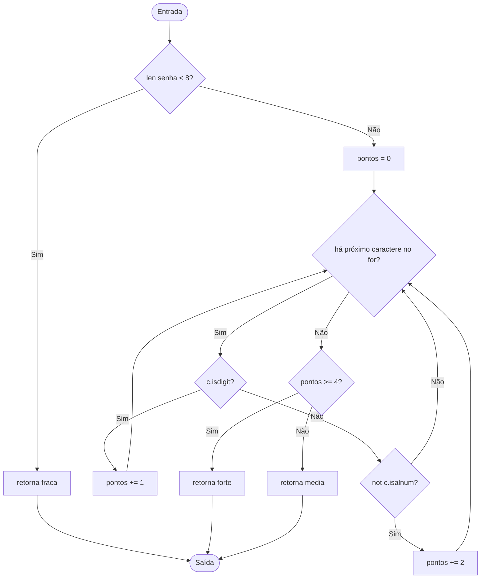

# Análise da função forca

## a) Grafo de fluxo de controle e complexidade

Contando os nós do grafo, há $N=13$ nós, $E=17$ arestas e um componente conexo ($P=1$). Pela fórmula de McCabe:

$$
V(G)=E-N+2P=17-13+2(1)=6
$$

Pela fórmula baseada no número de decisões, há cinco decisões: o if do tamanho, o for, o if de dígito, o elif de símbolo e o if do limiar de pontos. Portanto:

$$
V(G)=D+1=5+1=6
$$

## b) Base de caminhos independentes

| Caminho | Entrada | Saída esperada | Ramos exercitados |
|---|---|---|---|
| P1 | `abc` | `fraca` | senha curta e retorno antecipado |
| P2 | `abcdefgh` | `media` | senha válida; caracteres alfanuméricos; limiar falso |
| P3 | `1abcdefg` | `media` | ramo de dígito; limiar falso |
| P4 | `!abcdefg` | `media` | ramo de símbolo; limiar falso |
| P5 | `1234abcd` | `forte` | quatro dígitos; limiar verdadeiro; 8 iterações |
| P6 | `!!!abcdef` | `forte` | três símbolos; limiar verdadeiro; 9 iterações |

Os seis caminhos são linearmente independentes. Considere os vetores que contam quantas vezes cada caminho percorre cada aresta. Em uma combinação linear nula, com coeficientes $a_1,\ldots,a_6$, as arestas exclusivas do retorno antecipado, do retorno forte, dos ramos de dígito e símbolo e do retorno media impõem:

$$
a_1=0,\quad a_5+a_6=0,\quad a_3+4a_5=0,\quad a_4+3a_6=0,\quad a_2+a_3+a_4=0
$$

A aresta que entra no corpo do laço é percorrida 8 vezes por P2, P3, P4 e P5, e 9 vezes por P6. Logo:

$$
8a_2+8a_3+8a_4+8a_5+9a_6=0
$$

Substituindo as relações anteriores nessa equação, resulta $a_6=0$; consequentemente, $a_1=a_2=a_3=a_4=a_5=0$. Assim, nenhum caminho da base é combinação dos outros e os seis formam uma base, em concordância com $V(G)=6$.

O caminho que sai do for sem executar nenhuma iteração é inviável. Para alcançar o laço, a execução precisa passar pelo ramo len(senha) >= 8; portanto, sempre há pelo menos oito caracteres para percorrer. A condição de saída do for só acontece depois de processar esses caracteres.

## c) Testes parametrizados e cobertura de ramos

Os seis casos de test_caminhos_base correspondem aos seis caminhos independentes. Considerados em conjunto, exercitam os dois resultados de cada decisão, isto é, atingem 100% de cobertura de ramos. Os três casos adicionais de test_voltas_do_laco verificam iterações com 8, 9 e 20 caracteres.

O pytest-cov informa a cobertura agregada da execução, não uma porcentagem isolada para cada caso parametrizado. Assim, são seis casos na base, iguais a $V(G)$; com os três casos extras do laço, são nove casos parametrizados executados no total. A cobertura de ramos de 100% é da suíte/função como conjunto, não de cada teste individual.

Na execução completa da Aula 8, os 20 testes passaram. O relatório registrou forca.py com 100% de cobertura, incluindo 10 ramos e nenhum ramo parcial. Isso valida a cobertura de ramos da função para os casos da suíte; não elimina a inviabilidade de zero iterações nem torna testáveis comprimentos menores que 8 dentro do laço.

## d) Teste de laços

O laço executa uma volta para cada caractere da senha. Como ele só é alcançado quando o comprimento é pelo menos 8, os números possíveis de voltas são $8,9,10,\ldots$, sem um máximo definido pelo código. Os casos com 8, 9 e 20 caracteres testam o mínimo, uma volta além do mínimo e uma quantidade maior de iterações. Zero a sete voltas não são possíveis porque essas entradas retornam fraca antes do for.
