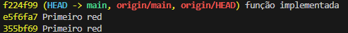

A) 

1 - "Dia dia DIA" dá {"dia": 3}
2 - "fim. Fim!"dá{"fim": 2}
3 - "bom\ndia" dá dois itens
4 - "dia a dia"dádia2ea1
5 - ",dia, ;dia;" dá {"dia": 2}
6 - "" dá {}
7 - "teste" dá {"teste": 1}
8 - "guarda-chuva" dá um item
9 - "... !" dá{}
10 - "bom dia" dá dois itens
11 - ":dia: ?dia?" dá {"dia": 2}

Justificativa -> Iniciei realizando transformando as palavras em LOWER, após fiz a retirada dos simblos expecificados no teste. Após iniciei o restante dos testes

C)

Não, existe primeiro o erro, após vem o primeiro green

D)

E)

11 testes

10 Passaram

1 Sobreviveu

10 / 11 = 90%